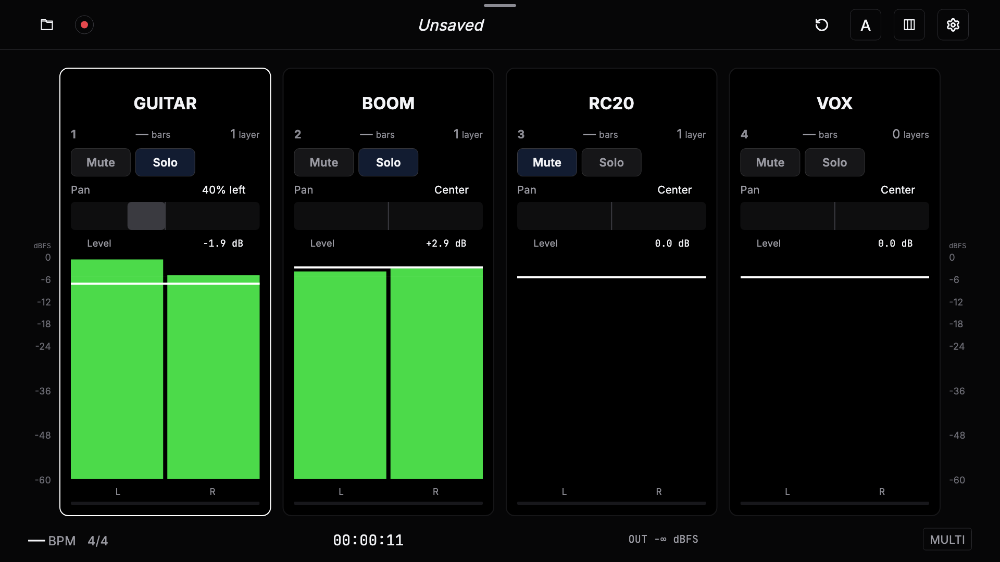
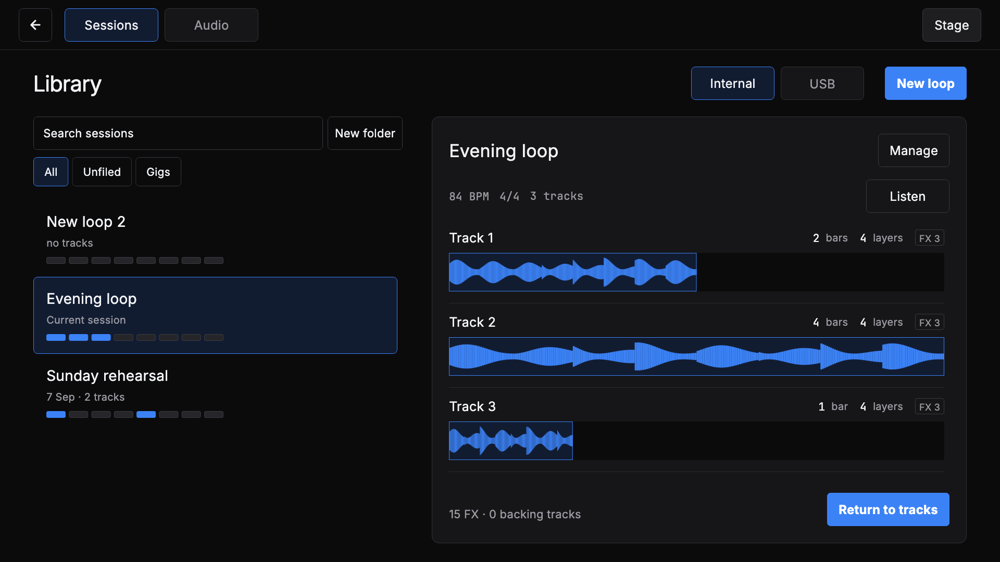
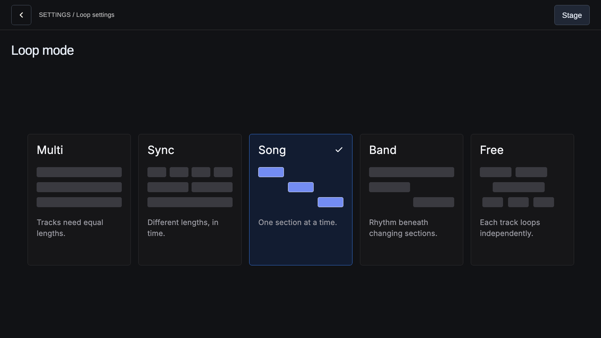
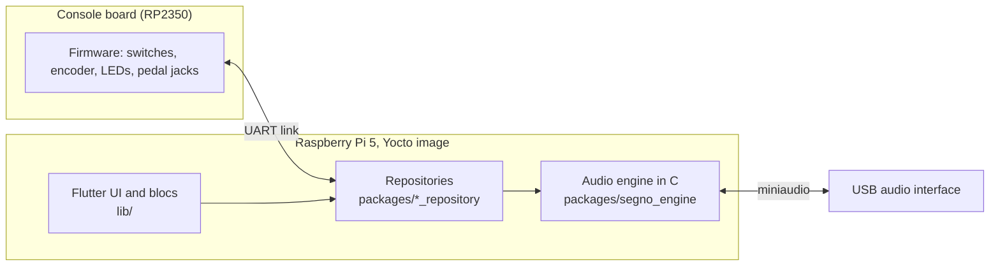

<p align="center">
  <picture>
    <source media="(prefers-color-scheme: dark)" srcset="tool/brand_assets/segno-glyph-white.svg">
    
  </picture>
</p>

<h1 align="center">Segno</h1>

<p align="center">
  A live looping instrument: a foot-operated console, two touch screens, and a
  native audio engine on a Raspberry Pi 5.
</p>

<p align="center">
  <a href="https://github.com/tomassasovsky/segno/actions/workflows/main.yaml"></a>
  <a href="LICENSE"></a>
  <a href="https://github.com/tomassasovsky/segno/releases"></a>
</p>

Segno records a phrase, plays it back in a loop, and lets you layer more parts
over it while you keep playing. It is built as a dedicated appliance rather than
a desktop app: the musician works it with ten footswitches and an encoder,
reads it from a 15.6-inch main screen and a 7-inch readout, and never needs a
computer on stage.

This repository holds all of it: the Flutter application, the C audio engine,
the console firmware, the circuit boards, the sheet-metal enclosure, and the
Yocto image that boots the appliance.



## What it does

- **Loops on eight tracks** in two banks of four, with record, overdub, undo
  and redo per track, mute, solo, pan, fades and reverse.
- **Five loop modes.** Multi, Sync, Song, Band and Free decide how track
  lengths relate and whether sections play together or one at a time. Tempo,
  time signature, click and count-in apply to all of them.
- **Effects** written in portable C, arranged as single effects or racks, and
  placed on live inputs, on recorded tracks, or on the outputs.
- **Virtual instruments** played from MIDI, recorded like any other input.
- **Backing tracks** that play alongside the loops.
- **A library** of saved sessions and audio, on internal storage or a USB
  drive, with search, folders, preview and backup.
- **Performance recording** to multitrack stems, with export to an Ableton
  Live set and a Mac companion app, [Segno Transfer](apps/segno_transfer/README.md),
  to download recordings over the network.
- **Control from anywhere on stage:** the built-in footswitches, external
  footswitches and expression pedals on two jacks, and MIDI over USB and DIN.
- **An appliance that maintains itself:** A/B system updates that roll back on
  failure, Wi-Fi setup, storage management and a tuner.

| Library | Loop modes |
|---|---|
|  |  |

The screenshots are captures from the application's own UI tests.

## Hardware

The console is a welded aluminum wedge. Its faceplate carries ten
footswitches with LED indicators (Record/Play, Stop, Undo, Mode, Track 1 to 4,
Clear and Bank), an encoder inside a 35-pixel LED ring, and the two screens.
Inside are a Raspberry Pi 5 with NVMe storage, a USB audio interface, and the
console board: a custom PCB with an RP2350 (Raspberry Pi Pico 2) that reads
the switches and drives the lights over a UART link to the Pi. The board also
provides DIN MIDI in and out, two jacks for external pedals, and USB-C Power
Delivery input.

The console firmware is a thin client. It reports raw switch, encoder and pedal
events and renders the LED frames the application sends back; all looper
behavior lives in the application.

See [hardware/](hardware) for the board designs, enclosure generator
and manufacturing package, and [firmware/](firmware) for the
microcontroller code.

## Architecture



- **Application** (`lib/`). Flutter, using the bloc pattern. It runs under the
  ivi-homescreen embedder directly on DRM/KMS, one engine per screen.
- **Repositories and clients** (`packages/`). The domain layer between the UI
  and the hardware: looper state, sessions, settings, pedals, MIDI, storage,
  updates, Wi-Fi. Presentation never talks to a data client directly.
- **Audio engine** (`packages/segno_engine`). A hand-written C engine on
  [miniaudio](https://miniaud.io). The audio callback never allocates or
  blocks; the UI sends commands through a lock-free ring and reads state from
  snapshots. Dart reaches it through FFI.
- **Appliance image** (`deploy/yocto`). A Yocto build for the Raspberry Pi 5
  with RAUC A/B updates. CI builds and publishes each image.

## Repository layout

| Path | Contents |
|---|---|
| [`lib/`](lib) | The Flutter application |
| [`packages/`](packages) | Repositories, data clients and the audio engine |
| [`apps/segno_transfer/`](apps/segno_transfer/README.md) | Mac app for downloading performance recordings |
| [`firmware/`](firmware) | Console board and LED ring firmware |
| [`hardware/`](hardware) | PCBs (KiCad), enclosure generator (Python/CadQuery), manufacturing files |
| [`deploy/`](deploy) | Yocto layer and appliance image configuration |
| [`docs/`](docs) | Status, design records and file-format specifications |
| [`test/`](test) | Application tests, including the screenshot tests |

## Building

Segno targets the appliance. A Mac can run the application for development,
and the mock flavor runs it without any audio hardware.

Requirements: Flutter 3.47, Xcode for the macOS host, and a C compiler for
the engine tests.

```sh
flutter pub get
flutter run -d macos --flavor development -t lib/main_mock.dart
```

Tests:

```sh
flutter test                                              # application
bash packages/segno_engine/src/test/run_native_tests.sh   # audio engine (C)
bash firmware/test/run_tests.sh                           # console link contract
```

Each package under `packages/` has its own tests. Building the
appliance image is described in [deploy/yocto](deploy/yocto/README.md), and
installing it on a Raspberry Pi in [docs/RUNNING_ON_RPI.md](docs/RUNNING_ON_RPI.md).

## Status

Segno is under active development by one person and has not had a stable
release. The application and engine run on the appliance, and experimental
images are published as
[pre-releases](https://github.com/tomassasovsky/segno/releases). The console
enclosure is designed and awaiting fabrication. Work is tracked in
[GitHub Issues](https://github.com/tomassasovsky/segno/issues), and
[docs/PROGRESS.md](docs/PROGRESS.md) records what has been built.

## Contributing

Bug reports and pull requests are welcome. Read
[CONTRIBUTING.md](CONTRIBUTING.md) first, and see [SECURITY.md](SECURITY.md)
for reporting vulnerabilities.

## License

Segno is free software, licensed under the
[GNU General Public License v3.0 or later](LICENSE). Third-party code under
`packages/segno_engine/third_party/` keeps its own licenses.

Created by [Tomás Sasovsky](https://github.com/tomassasovsky).
