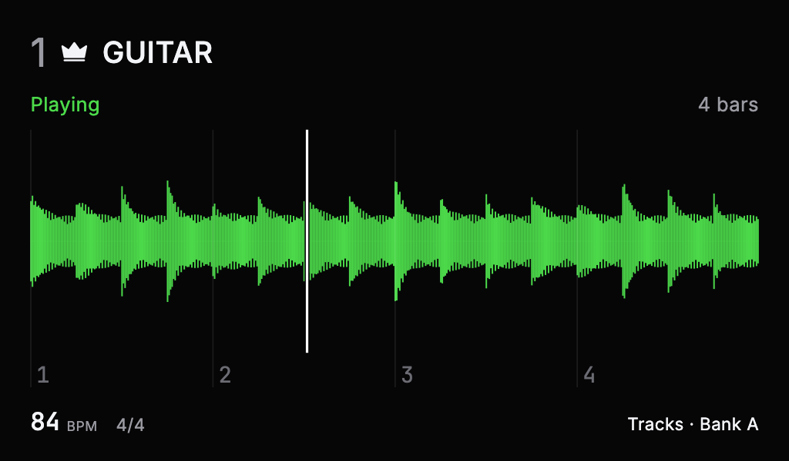
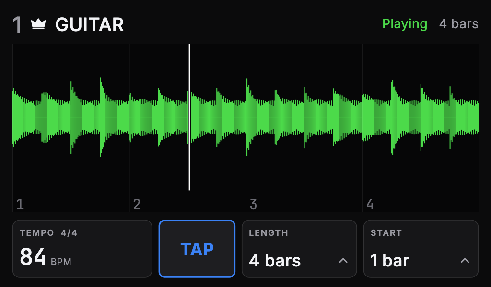
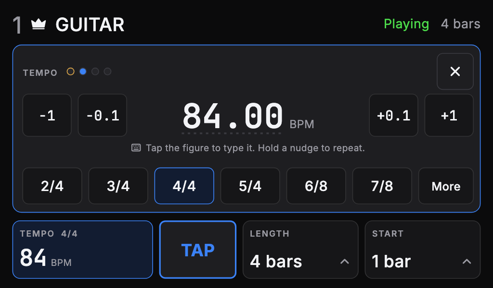
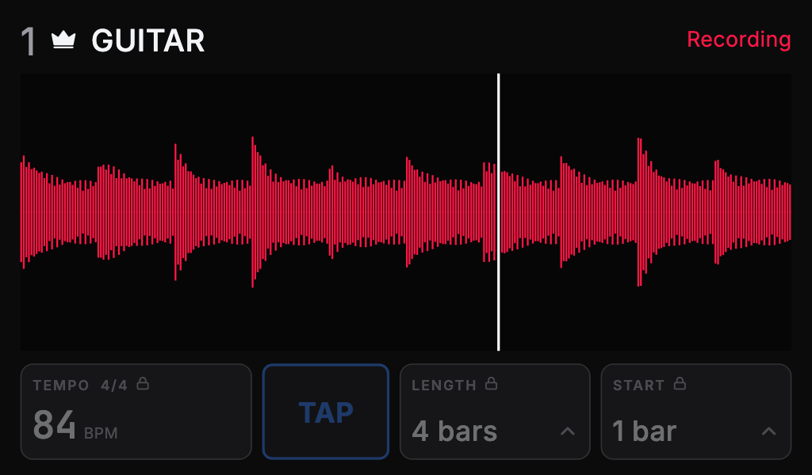
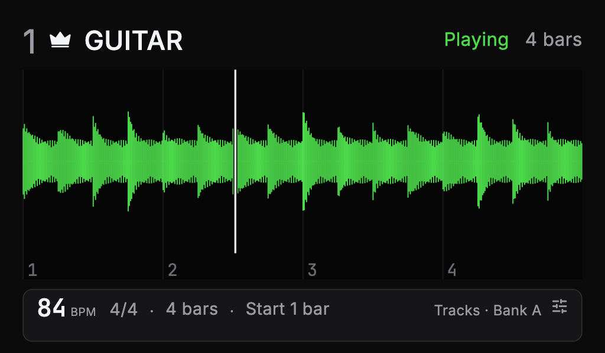
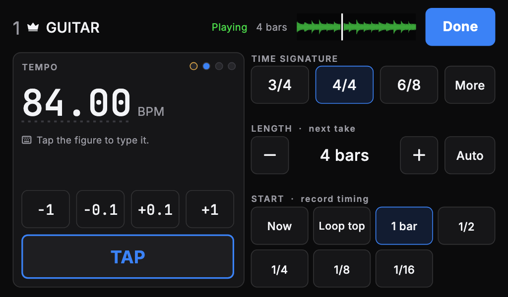
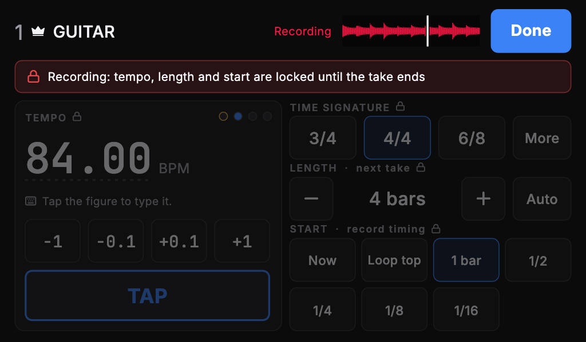
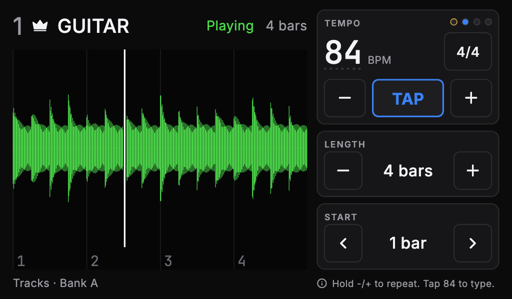
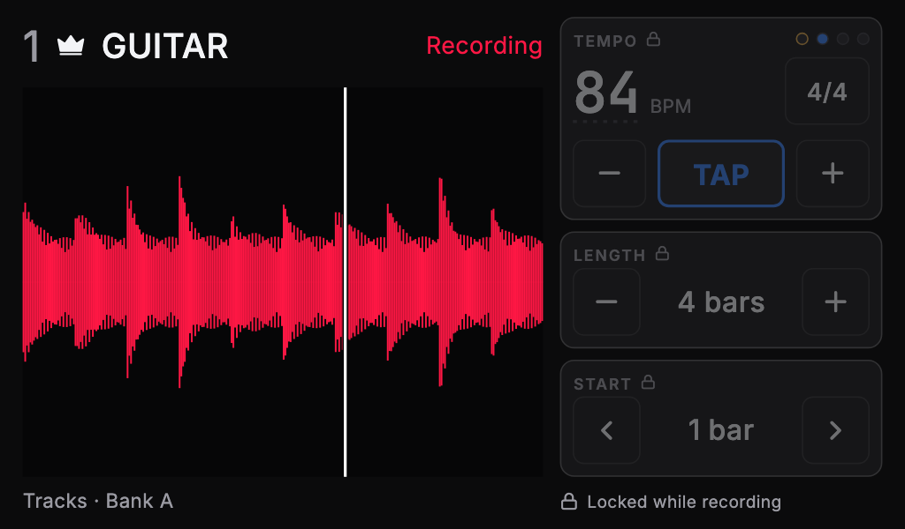
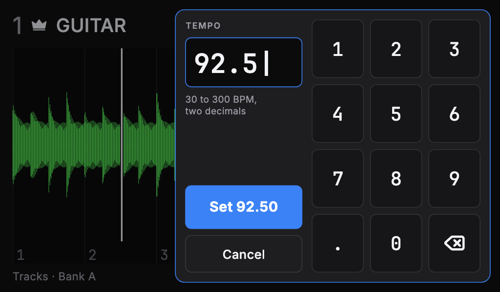

<!-- cspell:words Isotonik Sheeran HeadRush Helix mkII Ableton nudges nudged retimes retime retimed -->

# Tempo, loop length and record timing on the 7in readout

Tracking: [#1654](https://github.com/tomassasovsky/segno/issues/1654),
`stage:plan`, `autonomy:plan-gate`. Related:
[#1653](https://github.com/tomassasovsky/segno/issues/1653) (exact tempo entry
and Clear tempo on the main screen, in build), #1591 (the readout at its native
1024x600), #1562 (the notice band on the readout).

Every `file:line` below is on `claude/segno-integration` at `7142a1052`.

## Summary

- Today the readout only draws. A touch on it is sent to the main screen as
  activity and nothing else (`lib/visualizer/waveform_window.dart:87-91`).
- The owner wants to change the tempo, the time signature, the length of the
  next take in bars and the record timing from the readout, without opening
  Settings on the main screen.
- Three layouts are drawn below, at the readout's real size with the app's
  theme and fonts: **A** a control bar in place of the footer, **B** a footer
  strip that opens a full Loop panel on touch, **C** an always-on rail beside a
  narrower waveform. All three use the same exact-entry keypad and the same
  lock rules.
- Recommendation: **B**. The readout keeps its job as the 2-metre display, a
  stray touch during a song opens a panel instead of changing a setting, and
  the panel has room for every control at 48 px or more.
- Commands travel over the existing screen link as one new message kind,
  `command`, handled on the main screen by the settings owners that the Loop
  settings pages already use (`TempoSettings`, `RecordSettings`,
  `RecordTimingSettings`). The readout learns the result from its next readout
  push, as it does every other fact. No new channel and no reply protocol.

## 1. The readout today



Rendered with the screenshot harness from the real `ConsoleReadoutView` at
1024x600 physical, pixel ratio 1.6, so 640x375 logical, as #1591 runs it. The
console (`192.168.50.124`) did not answer on the network during this session,
so no `segno-capture` from the device is included; the harness render uses the
same widget, theme and fonts.

- `ConsoleReadoutView` scales a 1280x720 reference by the limiting axis
  (`console_readout_view.dart:46-61`). At 640x375 the scale is 0.5: the track
  number is 32 px, the state word 16 px and the footer tempo 20 px.
- The readout is a second Flutter engine with no repositories. It draws what
  the main screen sends: `waveform` frames and a `PerformanceReadout` map
  (`performance_readout.dart:157-273`), pushed only when it changes
  (`waveform_display_controller.dart:268-285`).
- Readout to main, there are two messages today: `activity`, which wakes an
  idle-dimmed console (`screen_link.dart:112`, handled at
  `app.dart:972`), and `calibrationTap` (`screen_link.dart:122`).
- The readout already carries tempo, tempo presence and the signature
  (`hasTempo`, `tsNum`, `tsDen`). It does not carry length, record timing or
  any lock state.

## 2. What the controls change, and when they are locked

The Loop settings pages call three application owners, built once in
`AppRuntime` (`lib/app/application/app_runtime.dart:65-74`). The cubits on the
pages (`TempoCubit`, `RecordTimingCubit`, `RecordOptionsCubit`) are thin
projections over them. The readout's commands should reach the same owners,
so a change from the readout is persisted, recalled and refused exactly as one
from the main screen.

| Control | Owner call | Persisted | Range |
|---|---|---|---|
| Tempo, exact or nudged | `TempoSettings.setTempo` (`tempo_settings.dart:192`) | yes | 30-300 BPM (`kTempoRange`, `tempo_state.dart:11`) |
| Tap | `TempoSettings.tapTempo` (`tempo_settings.dart:225`) | no, by design | engine's tap window |
| Time signature | `TempoSettings.setTimeSignature` (`tempo_settings.dart:204`) | yes | the 17 in `kValidTimeSignatures` |
| Length of the next take | `RecordSettings.setDefaultLengthBars` / `setTrackRecordLength` (`record_settings.dart:157-165`) | yes | Auto (0) or 1-64 bars |
| Record timing | `RecordTimingSettings.setTiming` / `setTrackTiming` (`record_timing_settings.dart:106-136`) | yes | 7 values of `RecordTiming` |

The locks already exist; the readout only has to show them.

- **Tempo.** The engine's D6 lock refuses manual tempo, signature and taps
  while any track has content and a grid exists, and during a count-in
  (`engine_process.c:713-725`). With content, a tempo change is allowed when it
  can retime the tracks that follow the tempo (#1179). The engine reports which
  case applies as `LooperState.tempoFollow`
  (`looper_state.dart:137`, `TempoFollowState` at
  `engine_snapshot.dart:417-443`): `free`, `retimes`, `noGrid`, `noFollower`,
  `busy`. An external MIDI clock also owns the tempo (#1228).
- **Time signature.** Locked whenever D6 locks, with no retime exception: in
  practice it can only change before the first take, as on the RC-600.
- **Length and record timing.** Locked only while a take records or overdubs
  (`RecordLengthSnapshot.canEdit`, `record_length.dart:98`, and the same in
  `RecordTimingSnapshot`). Otherwise they apply to the next take.

So "locked while recording" covers everything, but the tempo and signature
have a second, longer lock once loops exist, and the readout has to say which.

## 3. How established products do it

| Product | Tempo on a small screen | Length and quantize | Adopt |
|---|---|---|---|
| Boss RC-505mkII | Tempo shown on the main screen; turning an encoder while it shows changes it and the loops stretch to follow; tap tempo available | Per-track measure (Auto, Free or a count); quantize Measure, Beat or Off, applied to recording only | Length as Auto or a bar count; a tempo change on recorded loops retimes them |
| Boss RC-600 | Tap a switch to set tempo; a long press restores the previous tempo | Measure Auto/Free per track; the beat (signature) is set per memory before recording and cannot change after | Signature only before the first take, which matches D6 |
| Sheeran Looper X (HeadRush) | Tap tempo is a mode: the tempo shows across the top of the screen while it is active | Loop Settings page: length 0-64 bars, quantize to bar, 1/2, 1/4, 1/8, 1/16 | Our ranges and labels are already the Looper X's; a temporary tempo view over the normal screen |
| Line 6 Helix | Touching the tap switch opens the Tempo panel over the current view; the same settings live in Global Settings | n/a | A panel that opens on touch and goes away, with the full settings still in Settings |
| Ableton Push | Tempo encoder in 1 BPM steps, Shift for 0.1 BPM | n/a | Two nudge sizes, 1 and 0.1 BPM |
| Ableton Move | No tap button; tap pads then Capture sets the tempo | Max length setting, 16 bars by default | Nothing specific |

What to adopt:

1. Keep the tempo always visible, and make editing a temporary view over the
   normal screen (Helix's panel, Looper X's tap mode). The readout's main job,
   being readable from the floor, does not change.
2. Two nudge sizes, 1 and 0.1 BPM, with hold to repeat (Push). Hundredths go
   through the keypad, as on the main screen's Tempo page.
3. Length as Auto or a bar count, timing with the Looper X's five grid values
   plus Immediately and Loop start (already our model).
4. Show locks rather than hide controls: a dimmed control with the reason
   beside it, as the Loop settings pages do with `LoopLockBanner`.

## 4. Constraints

- 640x375 logical. A 48 px target leaves room for about six rows; the footer
  and header already take about 90 px.
- The readout is read from about 2 m (#701). Anything that shrinks the track
  name, state word and waveform for good costs that.
- A touch during a song must not change a setting by accident. Most of these
  settings are locked once loops exist, but the length and timing are not.
- The waking touch: on the main screen, the touch that wakes a dimmed console
  lands on a barrier and presses nothing (`IdleDimBarrier`,
  `idle_dim_host.dart:120-160`). The readout has no such barrier because
  nothing on it was pressable. With controls it needs one, and so it needs to
  know whether the console is dimmed.
- The encoder stays on the main screen. Everything on the readout is touch
  only.
- Tap tempo is timing-sensitive. The tap should fire on pointer down, not on
  release, and the extra hop through the main isolate adds latency the main
  screen's own Tap button does not have (section 7).

## 5. The options

Each option is drawn idle, editing and locked during a take. Every target is
48 logical px or more. Labels are English placeholders.

### A. Control bar

The footer becomes four tiles: Tempo (with the signature), Tap, Length,
Start. Tap acts at once. Tempo, Length and Start each open a sheet over the
waveform; the tempo sheet is drawn.

| Idle | Tempo sheet | Recording |
|---|---|---|
|  |  |  |

- For: Tap is one touch. The values are always shown in large type. The
  waveform keeps the full width.
- Against: the tiles take 76 px for good, so the waveform loses about a
  quarter of its height and the header is compacted. Tap, Length and Start
  are live targets on the performance screen all the time. Three separate
  sheets to build and test.

### B. Panel on touch (recommended)

The readout stays as it is, with one change: its footer becomes a strip that
names the tempo, signature, length and start, and is one touch target. A
touch opens the Loop panel over the readout, with every control on one
screen; the track, its state and a small waveform stay in view at the top.
Done, or 10 s without a touch, closes it.

| Idle | Panel | Recording |
|---|---|---|
|  |  |  |

- For: the readout is unchanged when nobody touches it. A stray touch opens
  the panel and changes nothing. One panel holds all four controls, so the
  timing choices are one touch each instead of a stepper. One surface to
  build.
- Against: every change is two touches (open, then act). The waveform is
  small while the panel is open.

### C. Side rail

A permanent right-hand rail of three blocks: tempo with -/+ and Tap and the
signature, a Length stepper, a Start stepper. The waveform narrows to the
left.

| Idle | Recording |
|---|---|
|  |  |

- For: every action is one touch, nothing opens or closes.
- Against: the waveform loses 40% of its width for good, which is the largest
  cost to the floor display. One nudge size only (fine steps through the
  keypad). Timing as a stepper means up to six touches to go from Immediately
  to 1/16. All controls are live all the time.

### Shared: exact entry



In every option, touching the tempo figure opens a keypad: 30.00 to 300.00
with two decimals, Set applies, Cancel leaves the tempo as it was. It is the
keypad #1653 adds to the main screen's Tempo page, sized for the readout, so
it is built once.

## 6. Lock states on screen

| State | Tempo and Tap | Signature | Length and Start |
|---|---|---|---|
| No loops (`free`) | editable | editable | editable |
| Loops that follow the tempo (`retimes`) | editable; the panel says the change retimes the following tracks | locked: "Clear all tracks to change it" | editable |
| Loops with no grid or no follower (`noGrid`, `noFollower`) | locked, with that reason | locked | editable |
| A take recording, or a count-in (`busy`) | locked: "Locked while recording" | locked | locked |
| External MIDI clock (#1228) | locked: "MIDI clock sets the tempo" | unchanged rules | editable |

The mockups draw the `busy` row. The panel (B) or the tiles and rail (A, C)
stay visible and dimmed with a lock mark, as the Loop settings pages show a
locked choice row.

## 7. How commands travel

One new message kind on the existing link, readout to main:

```text
{ op: 'command', kind: 'tempo.nudge', delta: 0.1 }
{ op: 'command', kind: 'tempo.set', bpm: 92.5 }
{ op: 'command', kind: 'tempo.tap' }
{ op: 'command', kind: 'signature.set', num: 6, den: 8 }
{ op: 'command', kind: 'length.set', bars: 4 }      // 0 is Auto
{ op: 'command', kind: 'timing.set', timing: 'bar' } // RecordTiming.name
```

- **Model.** A sealed `ReadoutCommand` in `lib/visualizer/`, with `toMap` and a
  tolerant `fromMap` like `PerformanceReadout`, so both engines share one
  schema. A garbled or unknown command is dropped.
- **Readout end.** `ReadoutScreenLink.sendCommand`, fire-and-forget like
  `sendActivity`. A command is also activity.
- **Main end.** `ScreenLinkWaveformService` gets an `onCommand` callback next
  to `onWindowActivity`. A small `ReadoutCommands` class in
  `lib/visualizer/application/`, built in `_AppViewState` beside
  `WaveformDisplayController`, maps each command onto the `AppRuntime` owners:
  nudges read the live tempo (`LooperState.transport.tempoBpm`) and clamp to
  `kTempoRange` before `setTempo`; `tempo.tap` calls `tapTempo` at once.
  Nudges are deltas so a repeated hold never works from a stale copy of the
  tempo on the readout.
- **Result.** No reply message. The readout shows the owners' accepted values
  from the next `PerformanceReadout` push, which runs on a 33 ms timer and
  only when the facts change. A refusal the owners already report (a
  recovery, a rejected edit) goes through the notice centre and so appears in
  the readout's band (#1562).
- **What the readout push gains.** `tempoFollow` (the `TempoFollowState`
  name), `clockOwnsTempo`, `lengthBars`, `timing`, `captureLocked`, and
  `dimmed` for the waking-touch barrier. `_sameReadoutFacts`
  (`waveform_display_controller.dart:321`) has to compare them too, or the
  diff gate will hold a stale readout. The beat lights need no new field: the
  readout derives the beat from the playhead progress, the bar count and the
  signature it already has.
- **Tap latency.** A readout tap goes through the readout's event loop, a
  `SendPort` hop and the main isolate's event loop before the engine stamps
  it. Both engines run in one process, so the hop itself is short, but a busy
  main isolate delays it. Measure on the console: taps at 120 BPM from the
  readout must land within 0.5 BPM of the same taps on the main screen. If
  they do not, carry the pointer-down timestamp in the command and add a
  timestamped tap to the engine; do not build that before the measurement
  says it is needed.

Everything about the panel itself (open or closed, the keypad draft, the
10 s close timer) is local to the readout engine. Only commands cross the
link.

## 8. Recommendation

Option B. It is the only option that leaves the floor display as it is when
nobody touches it, it fits all four controls at full target size on one
screen, and it follows the pattern the Helix and the Looper X use for the same
job: the tempo stays visible, and editing is a view that opens on demand.
Option A is the alternative if one-touch Tap matters more than the waveform's
height.

## 9. Questions for the owner

1. **Layout: A, B or C?** Recommendation: B.
2. **Which length and timing does the readout change: the default for all
   tracks, or the selected track's own?** Recommendation: the default, as the
   hub's summary shows it. When the selected track has its own value, the
   panel says so ("Track 2 uses 8 bars") and that override stays a main-screen
   edit. Editing the override implicitly when one exists would change what a
   touch does depending on state the player cannot see.
3. **Nudge steps.** Recommendation: 1 and 0.1 BPM, hold to repeat; hundredths
   through the keypad.
4. **Tempo changes that retime recorded loops.** Allowed from the readout, as
   on the main screen? Recommendation: yes, with the panel saying the change
   retimes the following tracks.
5. **Count-in on the panel?** The request names tempo, timing and bars.
   Recommendation: leave it out of the first version; there is room for one
   more row in B if it is wanted later.
6. **Clear tempo (#1653) on the readout?** Recommendation: no. It is rare and
   easy to hit by mistake; it stays on the main screen's Tempo page.

## 10. Plan outline (after the owner's pick)

The full plan goes in `docs/plan/` once the layout is chosen. Its shape for
B:

1. **Link and handler, no UI.** `ReadoutCommand`, `ScreenLinkOp.command`,
   `ReadoutScreenLink.sendCommand`, `onCommand` on the service, the
   `ReadoutCommands` handler on the owners, the new readout fields and their
   diff. Unit tests for the schema round trip, the handler against fakes of
   the three owners, and the diff gate.
2. **Readout UI.** The footer strip, the panel, the keypad from #1653, the
   lock lines, the waking-touch barrier. Widget tests for each lock state and
   a screenshot suite at 1024x600, pixel ratio 1.6. English and Spanish
   strings.
3. **Design writeback and device check.** Panel geometry into the Penpot file;
   on the console, the tap comparison from section 7 and a check that every
   target is reachable at the panel's edges after touch calibration.

## Sources

- [Boss RC-505 MkII review, Sound On Sound](https://www.soundonsound.com/reviews/boss-rc-505-mkii)
- [Boss RC-505 MkII review, MusicRadar](https://www.musicradar.com/reviews/boss-rc-505-mkii)
- [Boss RC-600 Parameter Manual](https://www.manualslib.com/manual/2340134/Boss-Rc-600.html)
- [RC-600: How do I set the time signature for recording, Roland support](https://support.roland.com/hc/en-us/articles/4410017677467-RC-600-How-do-I-set-the-time-signature-for-recording)
- [Sheeran Looper X FAQ, HeadRush support](https://support.headrushfx.com/en/support/solutions/articles/69000852044-sheeran-looper-x-frequently-asked-questions)
- [Helix Stadium manual, Line 6](https://manuals.line6.com/en/helix-stadium/live/tuner)
- [Ableton Push overview, Music Gurus](https://www.musicgurus.com/de/courses/sonicbloom-presents-push-the-envelope-become-pro-ableton-push/lessons/ableton-push-tutorial-overview)
- [Ableton Move release notes](https://www.ableton.com/en/release-notes/move-1/)
- [Ableton Move tap tempo, Isotonik Studios](https://isotonikstudios.com/ableton-move-tap-tempo-the-multiple-options-you-might-have-missed/)
