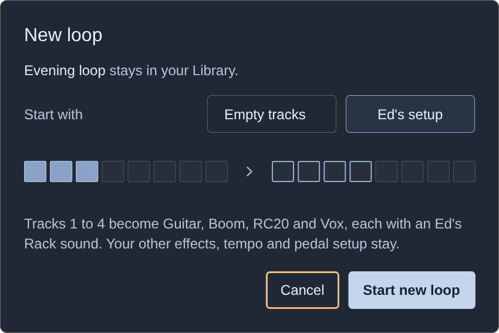
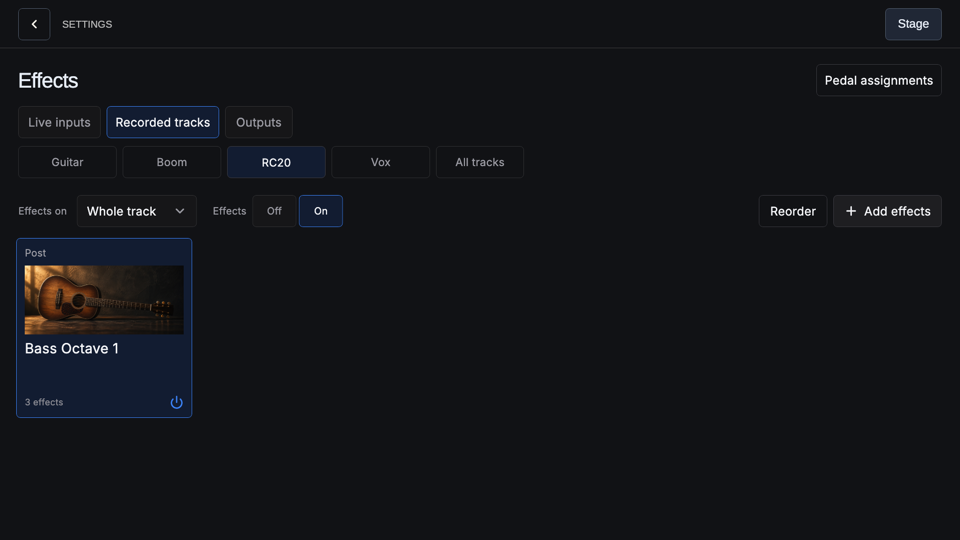
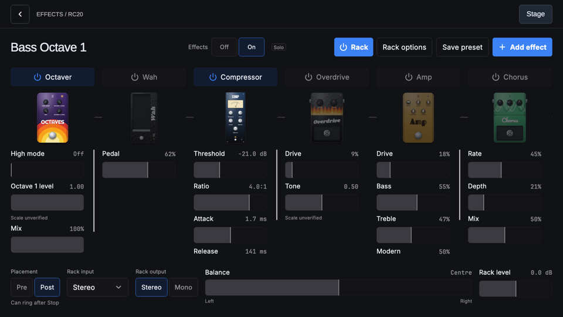
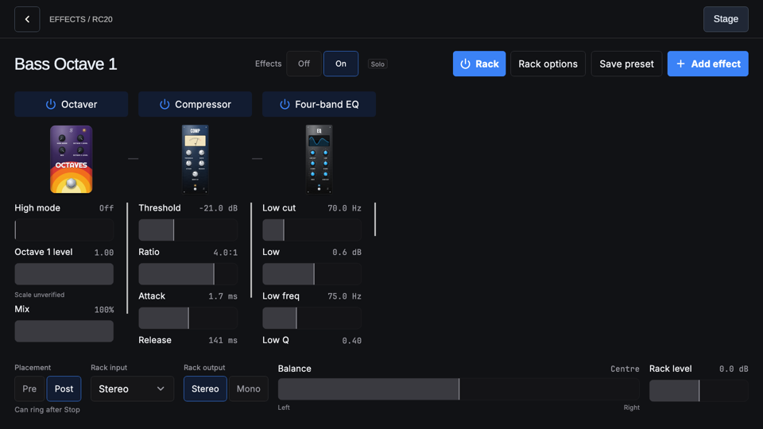

# Ed's setup: a one-step loop template

<!-- cspell:words Gearing Npk27GzXr70 edsguitar Kemper -->

Tracking: [#1513](https://github.com/tomassasovsky/segno/issues/1513),
`stage:plan`, `autonomy:plan-gate`. Branch `claude/eds-setup-1513`, cut from
the integration trunk (`claude/segno-integration`, `14a45f3e0`). Every
`file:line` below is on that commit.

This is a plan. Merging it approves the direction; the build follows under
#1513 once the owner has answered the questions in section 7 (each has a
recommendation, which the build takes if the owner merges without answering).

## 1. What it is

One choice when a loop starts: **Ed's setup** names tracks 1 to 4 Guitar,
Boom, RC20 and Vox and puts one factory Ed's Rack preset on each track's
chain. It is one step: choose it, start the loop, play.

## 2. What is established

- **Track roles.** No public source gives Ed Sheeran's per-song track
  settings. A third-party breakdown of his pedal (Oliver Gearing,
  <https://www.youtube.com/watch?v=Npk27GzXr70>, 08:18 to 08:41) labels his
  four tracks:
  - Guitar: chords and melodies.
  - Boom: beats from hitting the guitar body or muted strings.
  - RC20: a general track for vocals, guitar or beats.
  - Vox: backing vocals from a second mic used only for loops.
- **His tone is not recoverable.** Much of it is made at front of house
  (Kemper on the Mathematics tour; per-loop channels mixed by Chris Marsh),
  so no preset can claim to be his sound.
- **The sounds already ship.** The 36 factory Ed's Rack presets are in
  `packages/fx_catalogue/assets/presets/Ed's Rack/`.

The mapping below is **our inference**, not Ed's settings. The app must not
claim otherwise (D6).

| Track | Name | Preset | Why this preset | Pedals the preset turns on |
|---|---|---|---|---|
| 1 | Guitar | Acoustic Rhythm 1 | strummed acoustic chords | Compressor, Room reverb, EQ |
| 2 | Boom | Boom Dry | body hits stay tight and dry | Compressor, EQ |
| 3 | RC20 | Bass Octave 1 | an octave-down bass line played on the guitar | Dual octaver, Compressor, EQ |
| 4 | Vox | Vocal Close | a close backing vocal | Compressor, Room reverb, EQ |

Each preset builds nine pedals ([`fxRackEntries`](../../packages/looper_repository/lib/src/models/fx_module_build.dart),
line 832): Dual octaver, Wah, Compressor, Overdrive, Amp, Chorus, Room
reverb, Mode delay and EQ, with the ones above on and the rest off.

## 3. How established loopers do it

- **Sheeran Looper X** (User Guide v1.0.0). There is no template feature. A
  loop starts from New Loop ("discard the current loop and create a new
  loop", 5.7) or from a saved loop opened in the Loop Manager (5.7). Track
  names belong to the loop and are edited on the Track view (5.2). Each
  track's FX rack loads a factory or saved FX Rack preset (5.5.2). What
  carries into a new loop is a stated rule, not a surprise: the Mode pedal's
  custom layout carries over unless **Reset on New Loop** is on (5.9.6,
  Customize Pedal Menu).
- **Boss RC-600.** The owner's manual defines a **memory** as the settings for
  tracks 1 to 6 together with the input FX, track FX and rhythm; the unit
  stores 99. A performance starts by selecting a memory.

In both, the starting point is chosen when a loop starts, and the templates a
user makes are saved loops (Looper X) or memories (RC-600), not a separate
template object. Segno's Library already plays that role: a saved session is
a saved loop, and New loop keeps the current session's effects.

## 4. Current state (verified)

| What | Where |
|---|---|
| Library `New loop` button | `lib/library/view/library_page.dart:490` |
| The New loop sheet (always asks; Cancel changes nothing) | `lib/library/view/new_loop_sheet.dart:14-32`, `:38` |
| `SessionCubit.newLoop`: saves the outgoing rig first, then applies the empty rig through the Open path and saves it under the next automatic name | `lib/session/cubit/session_cubit.dart:551-620` |
| The empty rig keeps the live settings and every chain | `rigForNewLoop`, `lib/session/session_mapping.dart:370`; `Session.forNewLoop`, `packages/session_repository/lib/src/models/session.dart:1322` |
| Track chains are session-owned, keyed by channel, independent of a recorded track | `Session.trackChains`, `session.dart:902-916` |
| Track names are **global settings**, not part of a session | `TracksCubit.rename`, `lib/looper/cubit/tracks_cubit.dart:53`; `SettingsRepository.saveTrackName`, `packages/settings_repository/lib/src/settings_repository.dart:1937` |
| How Add effects builds a factory rack (FxRack id, preset name, art `edsguitar`; placement from the destination, Post on a recorded track) | `FxCubit`, `lib/looper/cubit/fx_cubit.dart:672-688`; `FxDestination.defaultPlacement`, `lib/looper/model/fx_destination.dart:125` |
| The effects budget is rig-wide, and an edit that adds processing is refused when it does not fit | `FxCubit._overBudget`, `fx_cubit.dart:216`; `LooperRepository.fxRoomNs`, `packages/looper_repository/lib/src/looper_repository.dart:8004` |
| A pedal is charged whether or not it is on, "so switching a pedal on is never refused" | `fxEntryCostNs`, `packages/looper_repository/lib/src/models/fx_cost.dart:114` |
| The catalogue loads lazily, once | `segnoFxCatalogue`, `lib/app/segno_navigator.dart:91` |
| FX mode: a track footswitch toggles that track's whole chain; Stop is inert unless bound | `ControlCubit.trackPressed`, `lib/control/cubit/control_cubit.dart:2062-2077`; `:1971-1976` |
| Two binding layers: global, and a session's own set that overrides the globals **wholesale** when it has any binding | `ControlState.bindings`, `lib/control/cubit/control_state.dart:272-309`; `PedalBindingSet.resolveAgainst`, `lib/control/binding/pedal_binding_set.dart:141` |
| A session saves the set in force, and New loop carries it into the new loop | `app_runtime.dart:176`; `session_cubit.dart:582`, `:596` |
| Pedal assignments edits the set in force and writes it to the globals, clearing a session set | `lib/control/view/fx_pedal_assignments_body.dart:247-264` |

## 5. Decisions

**D1. The choice lives in the New loop sheet.** The sheet gains one pick-one
row, **Start with: Empty tracks | Ed's setup**, with Empty tracks selected
when the sheet opens (today's New loop, unchanged). It is the only place a
loop starts, it already asks, and it already keeps the outgoing session. This
matches section 3: the starting point is a choice made when a loop starts.

Other surfaces were checked and rejected:

- **Loop setup** holds loop-wide settings only (Mode, Recording, Tempo,
  Length, Playback, Audio and tempo; `loop_settings_hub.dart`). Track names
  and effects are not there, and a hub row cannot start a loop.
- **The Effects library** puts one sound on one destination. It cannot name
  tracks or start a loop.
- **A new page** is not needed: one more value in an existing sheet does the
  job.

**D2. Loading always starts a new loop; it never edits the current session.**
Ed's setup runs New loop's existing steps first: a take in progress ends, the
outgoing session is saved when it has changed, and it stays in the Library
with its tracks and effects as they were. The new loop starts with no tracks.
Then, in the new loop only:

- tracks 1 to 4 (channels 0 to 3) get one rack each, replacing whatever chain
  those tracks carried, with the chain switched on;
- the loop-stage (lane) chains of channels 0 to 3 are dropped, so each of the
  four tracks sounds exactly like its rack;
- tracks 1 to 4 are renamed Guitar, Boom, RC20 and Vox.

Everything else is kept exactly as Empty tracks keeps it: input chains,
tracks 5 to 8, All tracks, output chains, tempo, mode, Fade, click, and the
pedal setup. The sheet says so in its summary line while Ed's setup is
chosen. There is nothing to ask before overwriting inside a session, because
no saved session is changed. The one change outside the session is the
track names (Q3).

**D3. All or nothing.** Before the new loop starts, the template is resolved:
the four presets are read from the catalogue and the rig the template would
build is checked against the effects budget (section 6). If either fails, the
summary line says why, Start new loop is disabled while Ed's setup is
chosen, and nothing changes. The rack chains go into the rig New loop
applies (one apply, one save), not as edits after it, so a refused or failed
apply leaves no half-built loop. The names are written after the apply
succeeds (including `newLoopNotSaved`, where the loop has started); a name
write that fails is reported like any other settings write and does not undo
the loop.

**D4. One built-in template, as data.** A const list of four entries
(channel, name, preset name) in the app, read by the sheet and by
`SessionCubit.newLoop`. No template file format, no "save as template", no
template list. Users already have templates in the form the Looper X and the
RC-600 use: a saved session in the Library, from which New loop keeps the
effects. If a second built-in template is ever wanted, the pick-one gains a
value; nothing here is built for it in advance.

**D5. The racks are built the way Add effects builds them.** The rack-building
branch of `FxCubit` (`fx_cubit.dart:672-688`: a fresh `FxRack` id, the
preset's name, art `kFxFamilySlugs[family]`, the entries of `fxRackEntries`
with the destination's placement) moves into one pure function that both
`FxCubit` and the template call, so a template rack cannot differ from a rack
added by hand. Placement is Post, the recorded-track default. Slot ids are
fresh (`withFreshSlotIds`).

**D6. Wording.** The option is "Ed's setup", the owner's name for it. The
summary line is "Tracks 1 to 4 become Guitar, Boom, RC20 and Vox, each with
an Ed's Rack sound. Your other effects, tempo and pedal setup stay." Nothing
in the app says these are Ed's own settings. English and Spanish strings
(`app_en.arb`, `app_es.arb`).

**D7. Out of scope.** Input routing (Vox expects a second microphone; which
input feeds which track stays the user's choice), Looper mode, tempo, and any
change to the Ed's Rack presets themselves.

## 6. Finding: the four full racks do not fit the 96 kHz effects budget

The console runs at 96 kHz. `fxEntryCostNs` charges every pedal in a chain,
on or off, so that switching a pedal on during a performance can never be
refused. Measured with the app's own cost model on the shipped presets
(a throwaway test against `fxRackEntries` and `fxChainCostNs`):

| | ns per frame |
|---|---|
| One full Ed's Rack (nine pedals) | 2,665 |
| Four full racks | 10,660 |
| Effects budget at 48 kHz, 64-frame blocks | 15,525 |
| Effects budget at 96 kHz, 64-frame blocks | 7,192 |
| Four racks, only the pedals each preset turns on | 2,997 |

The console's own table (#1508) lowers some charges (Room reverb, Amp, Dual
octaver) but not enough: four full racks still come to about 8,000 ns per
frame. So on the console, Ed's setup as specified (four full factory racks)
is refused by the same rule that refuses a user adding a third full rack by
hand. Q1 asks how to resolve it.

## 7. Questions for the owner

**Q1. How does Ed's setup fit the 96 kHz budget?**

- (a) **Recommended.** Each track gets the preset's sound, built from only the
  pedals the preset turns on (3, 2, 3 and 3 pedals; 2,997 ns per frame, 42 %
  of the budget). Every parameter is the preset's, so the sound is the
  preset's sound. The cost: a pedal the preset leaves off (the Wah on
  Guitar, say) is not in the rack; it can be added with Add effect. The rack
  keeps the preset's name.
- (b) Four full nine-pedal racks, and Ed's setup is unavailable at 96 kHz (the
  sheet says why). It works only at 48 kHz and below, which the console does
  not run.
- (c) Change the admission rule so that only pedals that are on are charged,
  and refuse a switch-on that does not fit. That reverses the rule in
  `fx_cost.dart` that a switch-on is never refused during a performance, so
  it would be its own plan-gate issue, not part of this one.

**Q2. Does Ed's setup also bind a footswitch to the RC20 track's Octaver?**

- **Recommended: no.** In FX mode, track 3's footswitch already switches the
  whole RC20 rack, whose sound is the octave; Pedal assignments binds the
  Octaver alone in two taps. A binding written by the template would change
  something beyond the four tracks, and both places it could live have a
  catch:
  - As a **global** binding it outlives the loop and changes every session
    that uses the globals. That is a change outside the session; it would
    have to be named in the sheet.
  - As the new loop's **session** binding set (the set in force plus one
    binding, on Stop, which is inert in FX mode), it replaces the globals
    wholesale while this loop is loaded (A12), and the first edit in Pedal
    assignments writes the whole set to the globals (`fx_pedal_assignments_body.dart:255-264`),
    so it reaches the globals anyway.
- If the owner wants it: the session-set form on Stop in FX mode, named in the
  sheet's summary line, with a test that the globals are unchanged after the
  new loop starts.

**Q3. Track names are shared by every session. Is that acceptable for Ed's
setup?**

Today a track name is a global setting, not part of a session. After Ed's
setup, reopening an older session shows its tracks named Guitar, Boom, RC20
and Vox, and names the user had typed for tracks 1 to 4 are replaced.

- **Recommended: keep names global for this issue, and say so.** When any of
  tracks 1 to 4 has a name other than its default or the template's, the
  sheet adds a line naming them: "Track names are shared by every session:
  Lead, Keys, Bass and Pad are replaced." Nothing changes silently.
- Alternative: make track names part of the session, as the Looper X does
  (5.2). That is a session-schema change with its own migration (#1196's
  path), and it changes every session, not only this template. It belongs in
  its own issue if the owner wants it, and Ed's setup would then write the
  names into the new loop only.

**Q4. The mapping.** Guitar = Acoustic Rhythm 1, Boom = Boom Dry, RC20 = Bass
Octave 1, Vox = Vocal Close (section 2). Override on #1513 if another preset
fits a track better; it is one line of data.

## 8. Implementation (one PR, about 300 production lines)

1. **Rack building** (`lib/looper/model/` or `looper_repository`): extract the
   FxRackChoice branch of `FxCubit` into a pure function; `FxCubit` calls it.
   With Q1 (a), the template filters to the pedals the preset turns on.
2. **Template data** (`lib/session/`): `edsSetup`, four (channel, name, preset
   name) entries, and a resolver that reads the presets from the loaded
   catalogue and returns the four chains or a refusal (preset missing, over
   budget).
3. **Session** (`session_cubit.dart`, `session_mapping.dart`): `newLoop` takes
   an optional template. `rigForNewLoop` replaces the track chains of channels
   0 to 3 and drops their lane chains. The budget check uses the
   repository's cost model against the open rate, the same rule as
   `FxCubit._overBudget`, on the rig the template would build.
4. **Names**: after a successful apply, `TracksCubit.rename` for channels 0 to
   3 (through `startNewLoop`, which already holds the session and library
   cubits; the session cubit does not learn about presentation names).
5. **Sheet** (`new_loop_sheet.dart`): the Start with pick-one (the designed
   pick-one control), the summary line, the Q3 line, the refusal line, and
   Start disabled while refused. Keys `new_loop_template_empty`,
   `new_loop_template_eds`.
6. **Strings**: `app_en.arb`, `app_es.arb`.

## 9. Acceptance criteria

1. Library > New loop shows Start with: Empty tracks | Ed's setup, Empty
   tracks selected. With Empty tracks, New loop behaves exactly as today.
2. With Ed's setup and Start new loop: the outgoing session is saved first and
   is unchanged in the Library; the new loop has no tracks; tracks 1 to 4 are
   named Guitar, Boom, RC20 and Vox; each of their track chains holds one rack
   named after its preset (art `edsguitar`, Post, chain on), and nothing else;
   their lane chains are empty; every other chain, tempo, mode and the pedal
   binding set are the same as Empty tracks would give.
3. Cancel changes nothing: no save, no new loop, no rename.
4. When a preset is missing or the template does not fit the budget at the
   open rate, the sheet says why, Start new loop is disabled for Ed's setup,
   and nothing changes. With Q1 (a), the template fits at 96 kHz with no
   other effects in the rig.
5. Under Q3's recommendation, the sheet names the track names it will replace
   when tracks 1 to 4 carry other names, and shows no such line when they do
   not.
6. Under Q2's recommendation, the global and session binding sets after the
   new loop starts are the ones Empty tracks gives.
7. The racks are the ones Add effects builds from the same preset (same
   entries, parameters and rack fields apart from ids), filtered per Q1.
8. The sheet matches Penpot `19 Sessions · New loop & recall` /
   `07 / New loop / Ed's setup`.

## 10. Tests

- **Data**: each of the four presets exists in the shipped `Ed's Rack`
  family and builds a non-empty rack; under Q1 (a) the four together cost no
  more than the 96 kHz budget; Bass Octave 1's rack holds a Dual octaver that
  is on.
- **Rack building**: the extracted function gives the same entries `FxCubit`
  gave before the move (existing `FxCubit` tests stay green).
- **Session** (`session_cubit_test.dart`): `newLoop(template: edsSetup)`
  applies a rig whose track chains 0 to 3 are the four racks and whose lane
  chains 0 to 3 are empty, with every other field equal to `rigForNewLoop`'s;
  the outgoing rig is saved before the apply; an over-budget template applies
  nothing and saves nothing.
- **Sheet** (`new_loop_sheet_test.dart`): default selection; the summary
  line per choice; the Q3 line with and without custom names; Start disabled
  with the refusal line; Start runs the template; Cancel runs nothing; the
  names are written only after a successful start.
- **Bindings**: after an Ed's setup new loop, `globalBindings` and
  `sessionBindings` equal what Empty tracks produces.
- **Screenshot**: the sheet with Ed's setup chosen, compared against the
  Penpot card.

## 11. Design

Penpot file `segno-ui`, page `01 CURRENT UX / 19 Sessions · New loop & recall`:

- New card `07 / New loop / Ed's setup`: the New loop sheet with the Start
  with row (Empty tracks | Ed's setup, Ed's setup chosen), the four new-loop
  tiles that get a sound outlined, and the summary line.
- Note `c/ Ed's setup (#1513)` beside it with the reasoning above.

The Q3 line and the refusal line are not drawn yet; the build adds them to
the card once Q1 and Q3 are answered.

Renders from the current app (a throwaway screenshot test, not committed):
the RC20 track after the template, and its rack under Q1 (b) and Q1 (a).

