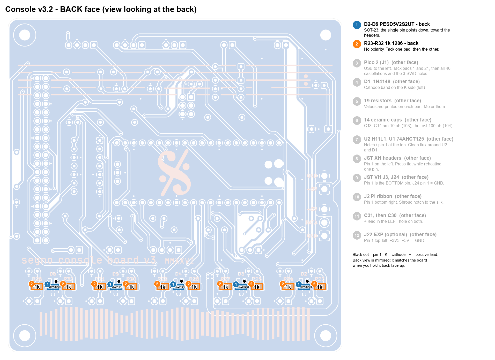
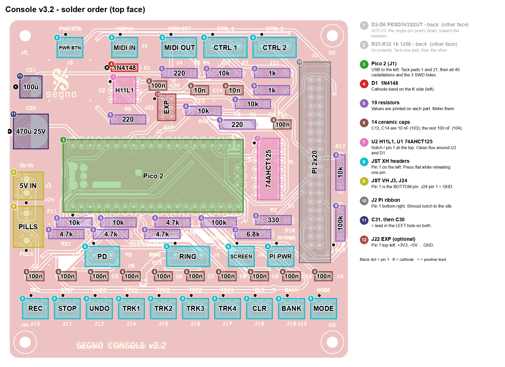
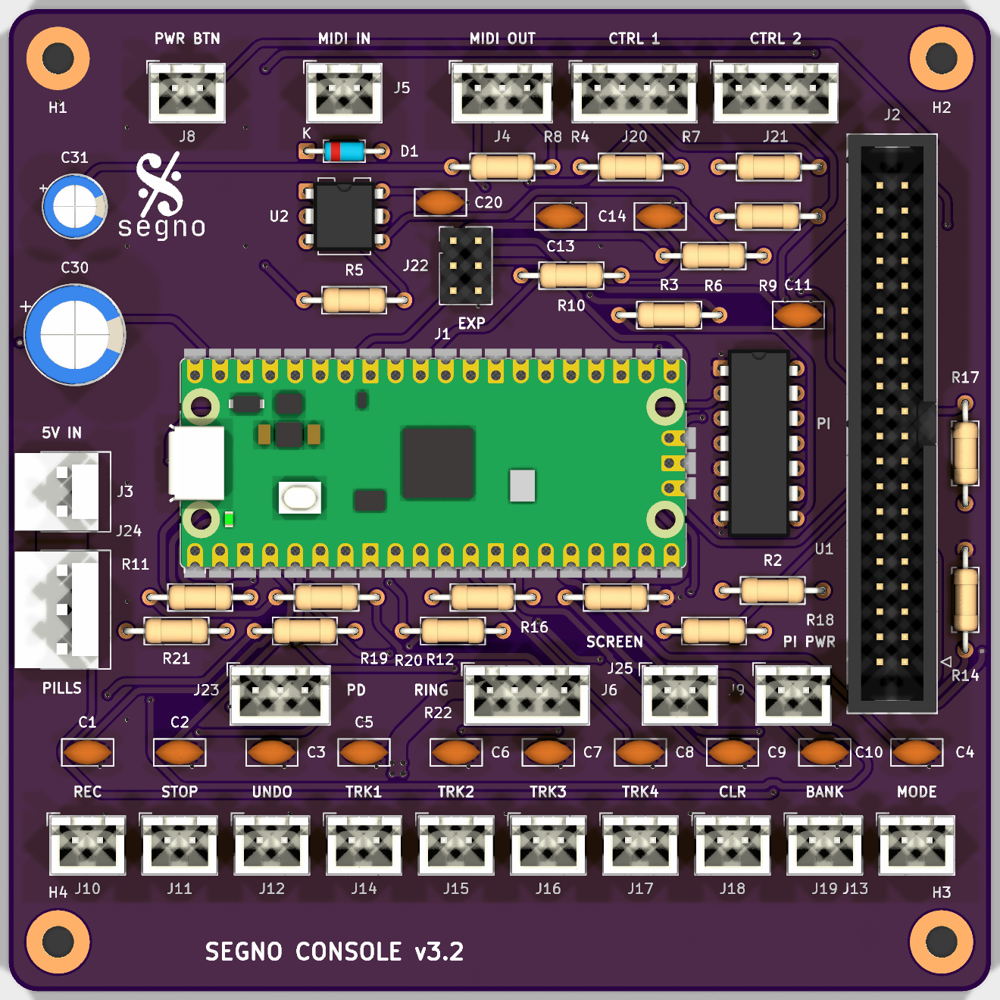
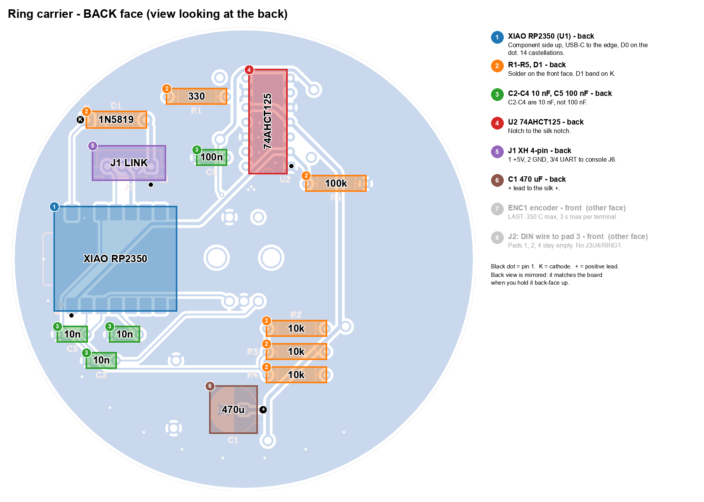
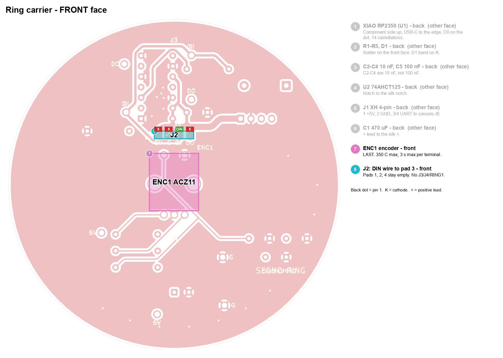
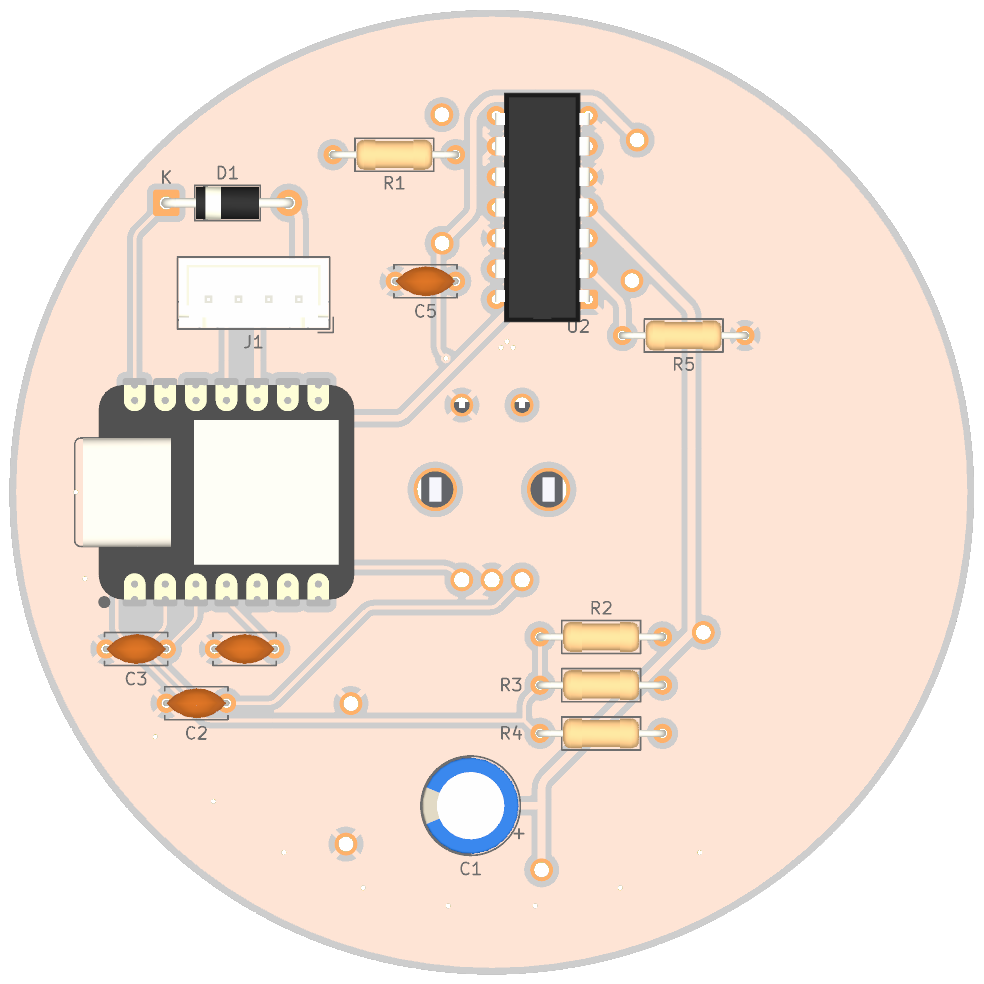
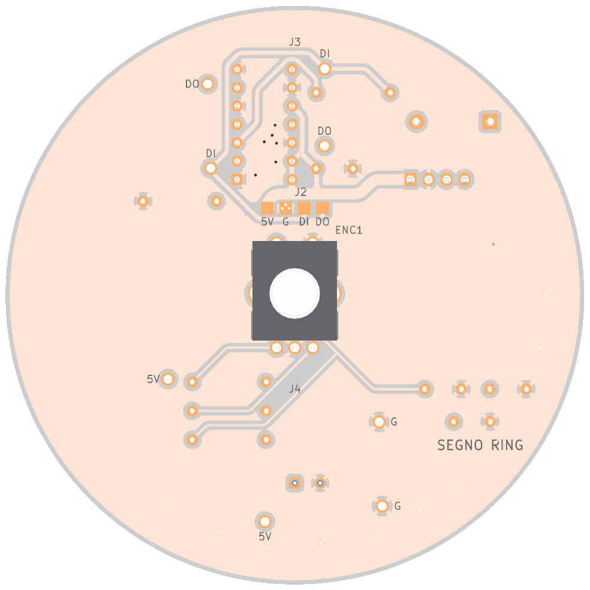
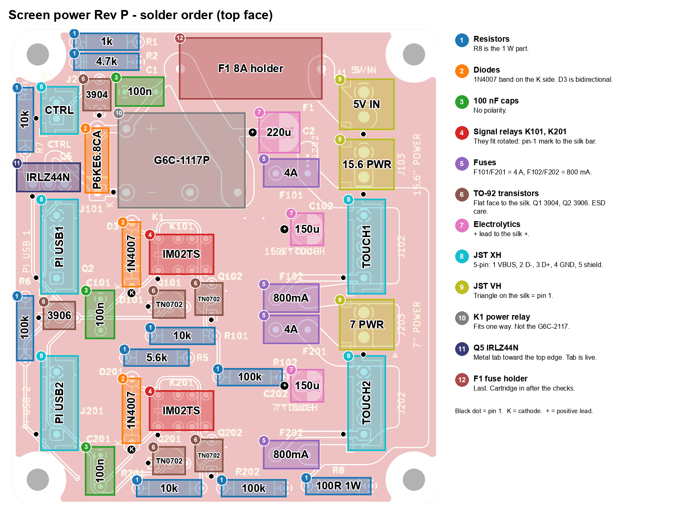
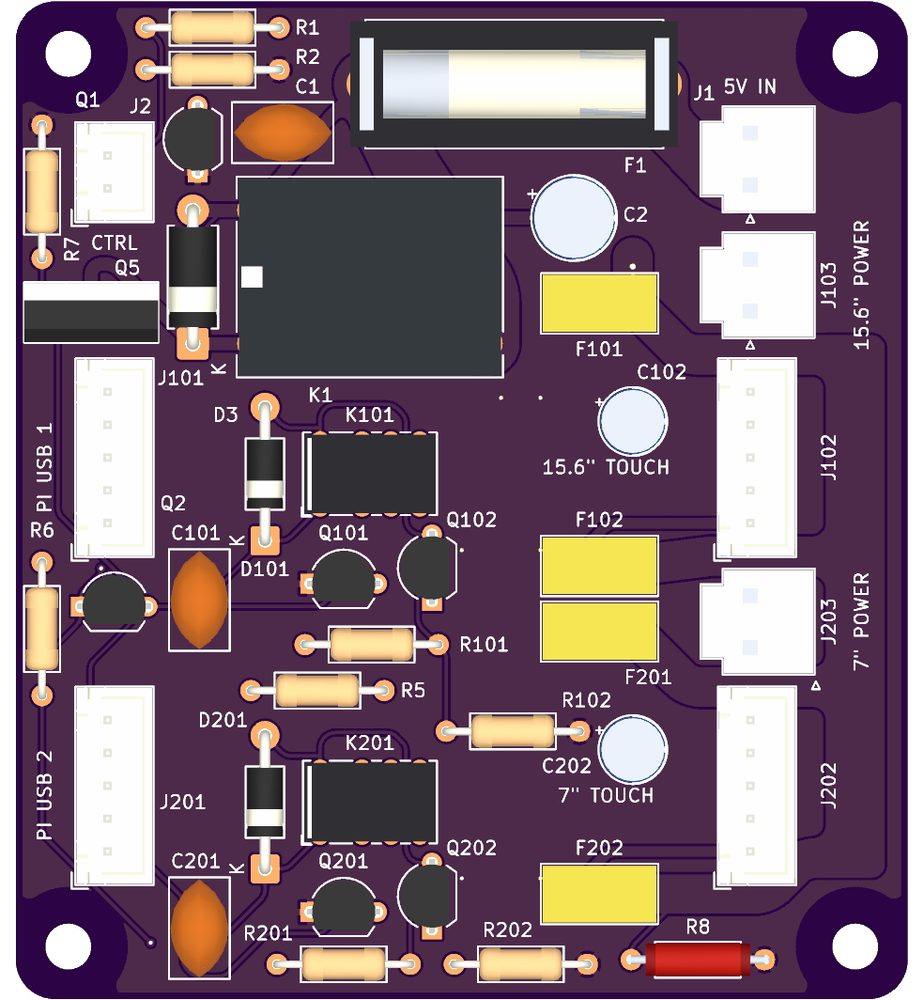

<!-- cspell:words EEUFR IRLZ NPBF Axicom Omron Schurter -->
# Segno V3 boards: solder order

Covers the three current boards. The ring carrier and screen-power archives
are the ones in the fabrication record,
`docs/reviews/pcb-finish-all-three-1072/manufacturing-zips.json`; the console
v3.2 archive (#1388, #1391) is listed in [the manufacturing notes](../MANUFACTURING.md)
and needs the owner's review before it is ordered.

| Board | KiCad file | Gerbers |
|---|---|---|
| Console v3.2 (Pico 2) | `hardware/kicad/out_console/segno_console_board.kicad_pcb` | `fab/segno_console_v3_2_gerbers.zip` |
| Ring carrier (XIAO RP2350, white) | `hardware/kicad/segno_pedal_ring.kicad_pcb` | `fab/segno_pedal_ring_gerbers.zip` |
| Screen power, Rev P | `hardware/kicad/screen_power/hand/screen_power_hand.kicad_pcb` | `fab/segno_screen_power_rev_p_gerbers.zip` |

General rule on every board: lowest parts first, tallest last, so the board
sits flat on the bench for as long as possible. Sort resistors with the meter,
not the colour bands.

Each board has a numbered solder-order image: every part is outlined in its
step colour with its value printed on it, a black dot marks pin 1, `K` marks a
diode cathode and `+` an electrolytic's positive lead. The `*_3d.png` files are
KiCad 3D renders of the same boards for reference. Run `tools/build.sh` to
regenerate the order images after a board changes (KiCad 10, ImageMagick and
Python 3 with Pillow).

Tools: temperature-controlled iron with a ~2 mm chisel tip, 0.6-0.8 mm
flux-cored solder, a flux pen (for the two castellated modules), flush cutters,
Kapton tape, a multimeter, isopropyl alcohol and a brush. A PCB holder helps on
the ring carrier, which has parts on both faces.

---

## 1. Console v3.2

The footswitch input protection (#1391) is on the **back**: five SOT-23 clamps
and ten 1206 resistors between the debounce caps and the footswitch headers,
the only surface-mount parts on the board. Fit them first, while the board
lies flat. Everything else goes on the top face and is through-hole, except
the Pico 2, which is soldered flat by its castellations.

### Parts

| Value | Refs |
|---|---|
| 220 Ω | R3, R4, R5 |
| 330 Ω | R2 |
| 1 kΩ | R7, R9 |
| 1 kΩ 1206 (back) | R23-R32 |
| PESD5V2S2UT, SOT-23 (back) | D2-D6 |
| 4.7 kΩ | R19, R20, R21, R22 |
| 6.8 kΩ 1% | R18 |
| 10 kΩ | R6, R8, R10, R11, R12, R17 |
| 100 kΩ | R14, R16 |
| 100 nF disc (`104`) | C1-C11, C20 |
| 10 nF disc (`103`) | C13, C14 |
| 100 µF 16 V radial | C31 |
| 470 µF 25 V low-ESR radial, Ø10 mm | C30 |
| 1N4148 | D1 |
| 74AHCT125N (must be AHCT) | U1 |
| H11L1 | U2 |
| Pico 2 (non-W) | J1 |
| JST XH 2-pin | J5, J8, J9, J10-J19, J25 |
| JST XH 3-pin | J4, J23 |
| JST XH 4-pin | J6, J20, J21 |
| JST VH 2-pin | J3 |
| JST VH 3-pin | J24 |
| 2×20 shrouded IDC (Würth 61204021621) | J2 |
| 2×3 header (Würth 61300621121), optional | J22 |

There is no R1, R13, R15 or J7 on v3.

### Bare-board check

J3 pin 1 to pin 2 (+5V to GND) open. J2 pin 1 to J2 pin 6 (+3V3 to GND) open.

### Order

1. **D2-D6 (PESD5V2S2UT), back.** Turn the board over. Each sits between two
   footswitch columns, just above the header row; the single pin (the common
   anode) points down, toward the headers. Flux, tack one corner pin, check
   all three pins sit on their pads, then solder the other two.
2. **R23-R32 (1 kΩ 1206), back.** One per footswitch column, lying across it
   between the debounce cap's pads and the header's pads. Tack one pad, then
   solder the other. Then meter each footswitch, console unpowered: header
   pin 1 to the cap's pin 1 above it reads 1 kΩ. In diode mode, red lead on
   header pin 1 and black on GND reads open (the clamp is reverse-biased);
   swapped, it reads about 0.7 V through the clamp. A short either way is a
   bridged SOT-23.
3. **Pico 2 (J1).** USB connector at the left end, toward `5V IN`. Pad 1 is
   bottom-left. Flux the pads, tape the module flat, tack pad 1 and pad 21
   (top-right), check alignment, then solder all 40 castellations. Leave the
   GND pads (3, 8, 13, 18, 23, 28, 33, 38) for last. Solder the three SWD
   holes at the right end too: the Pi reflashes the Pico through them, so they
   must be real joints. Then meter: pad 39 (VSYS) to J3 pin 1 short; pad 40
   (VBUS) to pad 39 open.
4. **D1 (1N4148)**, between `MIDI IN` and U2. Cathode band to the left, on the
   `K` mark.
5. **Resistors.** The silk labels in the two rows under the Pico are crowded, so
   go by position:
   - Under the rear headers (`MIDI OUT` / `CTRL 1` / `CTRL 2`), left to right:
     R4 220 Ω, R8 10 kΩ, R7 1 kΩ.
   - Next row down, right end: R9 1 kΩ. Then R6 10 kΩ, R10 10 kΩ, and R3 220 Ω
     on the rows below it.
   - Under U2, left of `EXP`: R5 220 Ω.
   - Row directly under the Pico, left to right: R11 10 kΩ, R12 10 kΩ,
     R20 4.7 kΩ, R16 100 kΩ.
   - Row below that, left to right: R21 4.7 kΩ, R22 4.7 kΩ, R19 4.7 kΩ,
     R18 6.8 kΩ.
   - Right of the Pico, under U1: R2 330 Ω.
   - Vertical, right of the ribbon header: R17 10 kΩ (upper), R14 100 kΩ (lower).
6. **Ceramic capacitors.** C1-C10 100 nF in the row above the footswitch
   headers. C11 100 nF above U1, C20 100 nF beside U2. C13 and C14 are the only
   10 nF (`103`) parts, between `MIDI OUT` and `CTRL 1`.
7. **U2 (H11L1)** and **U1 (74AHCT125N)**. Notch / pin 1 at the top (toward the
   rear-panel edge) on both. Solder two diagonal pins, check the package is
   flat, then the rest. Sockets are fine if you want them. Clean the flux
   around U2 and D1 afterwards: residue across the opto gap defeats the MIDI
   isolation.
8. **JST XH headers.** Pin 1 is on the left for every horizontal header. Solder
   one pin, press the housing flat while reheating, then the rest.
   - Top edge: J8 `PWR BTN`, J5 `MIDI IN`, J4 `MIDI OUT`, J20 `CTRL 1` (4-pin),
     J21 `CTRL 2` (4-pin).
   - Middle row: J23 `PD` (3-pin), J6 `RING` (4-pin), J25 `SCREEN`, J9 `PI PWR`.
   - Bottom edge, left to right: `REC STOP UNDO TRK1 TRK2 TRK3 TRK4 CLR BANK MODE`
     (J10 J11 J12 J14 J15 J16 J17 J18 J19 J13). `MODE` is at the right end on
     v3.1 and later because it moved to GP12 (#1388).
9. **JST VH headers** on the left edge: J3 `5V IN` (2-pin) and J24 `PILLS`
   (3-pin). Both are vertical; **pin 1 is the bottom pin**. J3 pin 1 is +5V;
   J24 pin 1 is GND, pin 2 data, pin 3 +5V.
10. **J2, Pi ribbon header.** Pin 1 is bottom-right, next to the small triangle
   by R14. Match the shroud's notch to the silk outline. Solder two diagonal
   corners, check it is square, then the rest. J2 pins 2 and 4 (Pi 5 V) are
   not connected on purpose.
11. **C31 (100 µF)**, then **C30 (470 µF)**, upper-left. **+ lead in the left
   hole** on both (silk `+`). C30 backwards will vent on first power-up.
12. **J22 `EXP`** (optional). 2×3, pin 1 top-left. Worth fitting on the first
    unit: pin 1 is +3V3, pin 2 is +5V and pin 6 is GND, which makes it the
    easiest test point on the board.

H1-H4 need no soldering. H1 is the single chassis-ground bond; keep screw heads
and standoffs at or under 6 mm diameter on H2-H4, or use insulating washers.

### Before power

Re-run the bare-board checks, plus: Pico pad 39 to J3 pin 1 short; J5 pin 1 and
pin 2 to GND open (> 1 MΩ). Program through the Pi's SWD link. Do not plug a
USB cable into the Pico while the AUX harness is attached: the Pico's VSYS diode
will energize the board's +5 V rail.

---

## 2. Ring carrier

This board has parts on **both faces**. The encoder (ENC1) and the LED wire
pads (J2) are on the **front**. Everything else, including the XIAO, is on the
**back**. The back images above are is the view looking at the back face, so it is
mirrored relative to KiCad's front view.

### Parts

| Value | Refs | Face |
|---|---|---|
| XIAO RP2350 | U1 | back, SMD castellations |
| 330 Ω | R1 | back |
| 10 kΩ | R2, R3, R4 | back |
| 100 kΩ | R5 | back |
| 1N5819 Schottky | D1 | back |
| 10 nF Vishay K103K10X7RF53H5 (5 mm pitch) | C2, C3, C4 | back |
| 100 nF (5 mm pitch) | C5 | back |
| 470 µF 16 V low-ESR, Ø8 mm | C1 | back |
| 74AHCT125N | U2 | back |
| JST XH 4-pin | J1 | back |
| Same Sky ACZ11BR1E-20FD1-20C (exact part) | ENC1 | front |

**Do not fit** J3, J4 or RING1 when using the external 40-LED strip. They are
the alternative 24/16-LED module footprints. Use only one LED option.

C2/C3/C4 are 10 nF, not the old 100 nF. C5 stays 100 nF.

### Bare-board check

J1 pin 1 to pin 2 (+5V_LED to GND) open.

### Order

1. **XIAO RP2350 (U1), back face.** Lay the board front-face down; nothing is
   on the front yet, so it sits flat. Place the XIAO component side up (USB-C
   and buttons facing away from the carrier), USB-C toward the nearest board
   edge, D0 on the silk pin-1 dot. Flux, tape, tack two opposite corners,
   check alignment, then solder all 14 castellations. The footprint only uses
   the 14 edge castellations; the module's underside pads stay unsoldered and
   sit on solder mask, so keep solder blobs out from under it. Meter: XIAO 5V
   pad to GND open, 3V3 pad to GND open, and no bridges between neighbours.
2. **Back-face axial parts: R1-R5 and D1.** These are inserted from the back and
   soldered on the front face. Tape them in place or use a holder before you
   flip the board. D1 (1N5819): cathode band toward the `K` mark.
3. **C2, C3, C4 (10 nF) and C5 (100 nF)**, back face.
4. **U2 (74AHCT125N)**, back face. Match the notch to the silk notch. Solder two
   diagonal pins first.
5. **J1 (XH 4-pin)**, back face. Pin 1 = +5V, 2 = GND, 3/4 = UART link to
   console J6 pins 3/4.
6. **C1 (470 µF)**, back face. Tallest back part. + lead to the silk `+`.
7. **ENC1, front face, last.** It is the tallest part and it has a heat limit:
   **350 °C maximum, 3 seconds maximum per terminal.** Insert from the front,
   check it is square, then solder the five terminals from the back face (A, C,
   B, S1, S2), letting each cool before the next. The two 3 mm mounting tabs
   take more heat; use a larger tip and work quickly rather than holding the
   iron there. With parts now on both faces, the board will not lie flat, so
   use the holder.
8. **LED strip DIN to J2 pin 3 only** (front-face SMD pad). Leave J2 pins 1, 2
   and 4 empty. Strip power does not go through this board.

### Harness (not on the PCB)

From `RING_ASSEMBLY.md`: the strip's +5 V/GND and ring J1 pins 1/2 each get
their own short 22 AWG pair from a near-ring AUX split (16 AWG trunk, at most
600 mm; pairs at most 50 mm). Console J6 cavities 1/2 stay empty: this is not a
straight-through cable. Fit the Panasonic EEUFR1A102 1000 µF / 10 V directly
across the strip's power entry (stripe to GND), sleeved and strain-relieved.
Keep DIN at most 100 mm.

---

## 3. Screen power board, Rev P

All parts on the top face, all through-hole. Two TN0702 MOSFETs per channel and
the IRLZ44N are ESD-sensitive; ground yourself before handling them.

### Parts

| Value | Refs |
|---|---|
| 1 kΩ 1% | R1 |
| 4.7 kΩ 1% | R2 |
| 5.6 kΩ 1% | R5 |
| 10 kΩ 1% | R7, R101, R201 |
| 100 kΩ 1% | R6, R102, R202 |
| 100 Ω 1 W | R8 |
| 1N4007 | D101, D201 |
| P6KE6.8CA (bidirectional TVS) | D3 |
| 100 nF 50 V disc, 7.5 mm | C1, C101, C201 |
| 150 µF 10 V radial | C102, C202 |
| 220 µF 10 V radial | C2 |
| Bel 0697H 4 A time-lag | F101, F201 |
| Bel 0697H 800 mA time-lag | F102, F202 |
| 2N3904 (NPN) | Q1 |
| 2N3906 (PNP) | Q2 |
| TN0702N3-G | Q101, Q102, Q201, Q202 |
| IRLZ44NPBF, TO-220 | Q5 |
| TE/Axicom IM02TS (1-1462037-3) | K101, K201 |
| Omron G6C-1117P-US DC5 | K1 |
| Schurter OGN 0031.8201 holder + SPT 8 A cartridge | F1 |
| JST XH 2-pin | J2 |
| JST XH 5-pin | J101, J102, J201, J202 |
| JST VH 2-pin | J1, J103, J203 |

### Order

1. **Resistors.** All flat axial parts. R6 and R7 stand vertical on the left edge.
   R8 is the 1 W part (larger body), bottom-right.
2. **D101 and D201 (1N4007).** Cathode band toward the `K` mark, which is at
   the lower end of each. D3 (P6KE6.8CA) is bidirectional and can go either way.
3. **C1, C101, C201** (100 nF discs).
4. **K101 and K201 (IM02TS).** Low-profile signal relays. The pin grid will
   accept them rotated, so match the relay's pin-1 marking to the bar on the
   silk outline (left end). Coil 1+/8−; commons 3/6.
5. **Fuses F101, F102, F201, F202.** Read the print before fitting:
   F101/F201 are 4 A, F102/F202 are 800 mA. They are not polarized.
6. **TO-92 transistors.** Match each flat face to the silk; they do not all face
   the same way. Q1 is the 2N3904 and Q2 the 2N3906, so read the marking before
   fitting. Q101/Q102/Q201/Q202 are TN0702 (S/G/D). Keep the iron on each lead
   briefly.
7. **Electrolytics: C102, C202 (150 µF), C2 (220 µF).** + lead to the silk `+`.
8. **JST XH:** J2 `CTRL` (2-pin, pin 1 = GPIO17, pin 2 = GND); J101, J102, J201,
   J202 (5-pin: 1 VBUS, 2 D−, 3 D+, 4 GND, 5 shield).
9. **JST VH:** J1 `5V IN`, J103 `15.6" POWER`, J203 `7" POWER`. The triangle on
   the silk marks pin 1.
10. **K1 (Omron G6C-1117P-US).** Pin pattern is asymmetric, so it fits one way.
    Do not substitute the two-pole G6C-2117.
11. **Q5 (IRLZ44N), vertical TO-220,** left edge. Metal tab toward the top edge
    of the board (toward J2 `CTRL`); the silk outline has a line across it on
    the tab side. Pin 1 gate, 2 drain, 3 source. The tab is the drain and is
    electrically live; keep it clear of metal in the enclosure. No heatsink
    needed.
12. **F1 holder** last (tallest). Insert the 8 A cartridge only after the checks
    below, with power disconnected.

### Before power

From `screen_power/README.md` "First assembly": check supply polarity, shorts
between J1 pins, cartridge seating, cable pin order and Q5 tab clearance. Verify
each five-pin USB harness map and shell-to-pin-5 continuity before connecting
the Pi or the screens.
